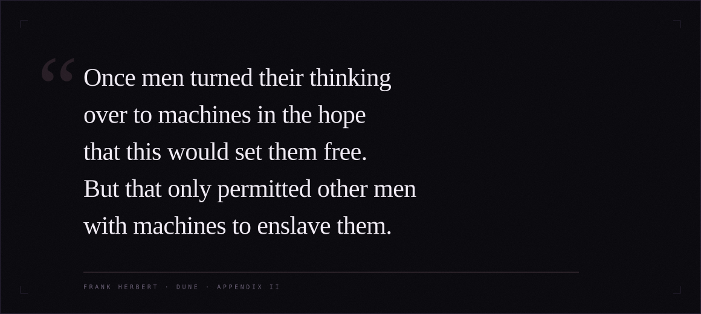
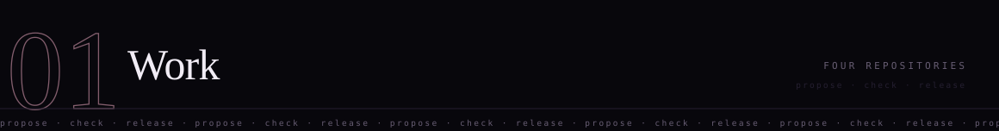
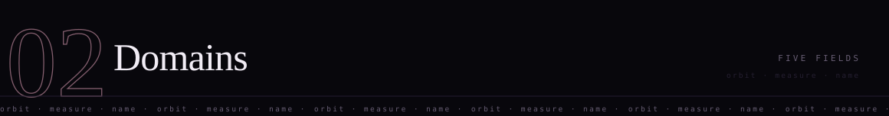
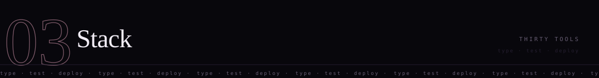
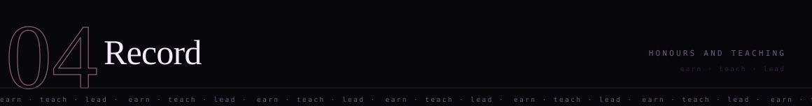
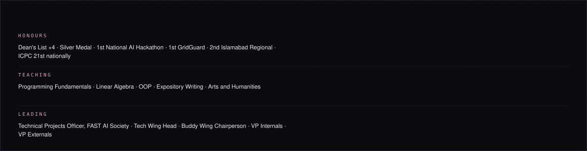

<picture>
  <source media="(prefers-color-scheme: dark)" srcset="./assets/plates/hero_dark.svg" />
  <source media="(prefers-color-scheme: light)" srcset="./assets/plates/hero_light.svg" />
  
</picture>

<a href="https://ibtasaam.com">ibtasaam.com</a> &nbsp;·&nbsp; <a href="mailto:ibtasaam.mughal@gmail.com">ibtasaam.mughal@gmail.com</a> &nbsp;·&nbsp; <a href="https://www.linkedin.com/in/muhammad-ibtasaam-amjad">LinkedIn</a> &nbsp;·&nbsp; <a href="https://ibtasaam.com/cv/muhammad-ibtasaam-amjad-cv.pdf">CV</a>

<picture>
  <source media="(prefers-color-scheme: dark)" srcset="./assets/plates/quote_dark.svg" />
  <source media="(prefers-color-scheme: light)" srcset="./assets/plates/quote_light.svg" />
  
</picture>

<picture>
  <source media="(prefers-color-scheme: dark)" srcset="./assets/plates/sec_work_dark.svg" />
  <source media="(prefers-color-scheme: light)" srcset="./assets/plates/sec_work_light.svg" />
  
</picture>

### [Pokayoke](https://github.com/Mughal-Hash-24/pokayoke)
`Python` `FastAPI` `Google ADK` `MCP` `Cloud Run` `React`

Holds suspect financial records before they reach the database, shows the evidence behind every correction, and will not release a row until an analyst signs off. First place, National AI Hackathon 2026.

### The Odyssey
`Python` `FastAPI` `MCP` `Redis` `n8n`

A WhatsApp-facing ReAct orchestrator. Iris delegates over MCP to specialist systems for retrieval, writing, Workspace control and engineering, with per-sender memory behind a live swarm dashboard.

### Musannif
`Python` `Textual` `NetworkX` `Anthropic` `Mistral`

Turns a topic into an editable outline, schedules sections on a dependency graph, then generates them with nine specialists. You edit the plan before a word is written.

### AI Agent Security
`Python` `Kaggle` `aicomp_sdk`

Red-team search against a sandboxed tool-using agent for the OpenAI, Google and IEEE challenge. Seven prompt templates, replay-validated scoring, candidate deduplication, a hard evaluation budget. Peak rank **40th worldwide**.

### Wisdom / Kybernetes
`Obsidian` `Python` `MCP`

The vault I actually live in, exposed to agents through hand-written MCP tools for search, note management and workflows.

### Maktaba
`Next.js 15` `React 19` `TypeScript` `D3` `Supabase`

That vault, published: **370 linked notes, roughly 896,000 words**, a 4,196-section semantic index and a graph you can walk. Hikma reads it back to you.

### NAaaS / NewsNet
`Python` `spaCy` `DeBERTa-v3` `FAISS` `Leiden`

News knowledge-graph research. Fine-tuned DeBERTa-v3 NER at **93.68% micro F1 on 8,262 OntoNotes sentences**, against an 87.19% spaCy baseline.

 

<picture>
  <source media="(prefers-color-scheme: dark)" srcset="./assets/plates/sec_domains_dark.svg" />
  <source media="(prefers-color-scheme: light)" srcset="./assets/plates/sec_domains_light.svg" />
  
</picture>

<picture>
  <source media="(prefers-color-scheme: dark)" srcset="./assets/plates/domains_dark.svg" />
  <source media="(prefers-color-scheme: light)" srcset="./assets/plates/domains_light.svg" />
  
</picture>

 

<picture>
  <source media="(prefers-color-scheme: dark)" srcset="./assets/plates/sec_stack_dark.svg" />
  <source media="(prefers-color-scheme: light)" srcset="./assets/plates/sec_stack_light.svg" />
  
</picture>

<picture>
  <source media="(prefers-color-scheme: dark)" srcset="./assets/plates/stack_dark.svg" />
  <source media="(prefers-color-scheme: light)" srcset="./assets/plates/stack_light.svg" />
  
</picture>

 

<picture>
  <source media="(prefers-color-scheme: dark)" srcset="./assets/plates/sec_record_dark.svg" />
  <source media="(prefers-color-scheme: light)" srcset="./assets/plates/sec_record_light.svg" />
  
</picture>

<picture>
  <source media="(prefers-color-scheme: dark)" srcset="./assets/plates/record_dark.svg" />
  <source media="(prefers-color-scheme: light)" srcset="./assets/plates/record_light.svg" />
  
</picture>

&nbsp;&nbsp;<b>Everything else</b> &nbsp;other builds, societies, detours

 

**Elsewhere** · Verteon, offline posture correction on ESP32, BLE, Rust and Tauri · TaxNet, graph tax intelligence at ~0.90 F1 over 110,000 records in 48 hours · GridGuard, inspection dashboard across 7,442 meters and 11 DISCOs · Proxenos, B2B escrow on Solidity and Spring Boot · Islamagood and Baghdad Reimagined, classical-AI city simulators · Chrono-Rift, multi-process C++ on POSIX shared memory · Super Mario Bros in x86 MASM · ConsoleGraphicsExtension, a WinAPI console graphics library

**Events** · Head of Event, Speed UML, NaSCon 2026 · Vice Head, Speed Programming, NaSCon 2026 · Technical Projects Officer, FAST AI Society, where the LangChain and n8n automation runs university-wide

