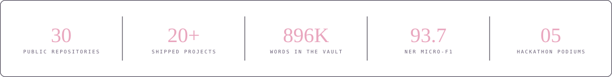
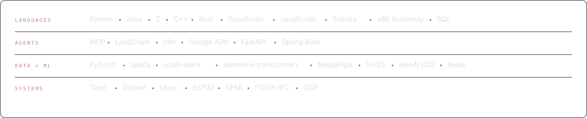

<picture>
  <source media="(prefers-color-scheme: dark)" srcset="./assets/readme/rose_dark.svg" />
  <source media="(prefers-color-scheme: light)" srcset="./assets/readme/rose_light.svg" />
  
</picture>

# Muhammad Ibtasaam Amjad

CS at FAST-NUCES Islamabad 
CTO, Verteon · Rawalpindi, Pakistan

I build agentic systems, then I build the thing that checks them.

**Record** &nbsp;1st, National AI Hackathon 2026 · 5 hackathon podiums · 
ICPC 21st nationally · Dean's List ×4 · CGPA 3.86

[ibtasaam.com](https://ibtasaam.com) · [ibtasaam.mughal@gmail.com](mailto:ibtasaam.mughal@gmail.com) 
[LinkedIn](https://www.linkedin.com/in/muhammad-ibtasaam-amjad) · [Download CV](https://ibtasaam.com/cv/muhammad-ibtasaam-amjad-cv.pdf)

 

 

> **Once men turned their thinking over to machines in the hope that this would set them free. But that only permitted other men with machines to enslave them.**
>
> Frank Herbert, *Dune*, Appendix II, "The Religion of Dune"

Herbert was warning about systems like mine. That line is the standard I hold the work to. Every system I ship has to leave the judgement with the person using it: the machine proposes, the human decides, and nobody's thinking gets quietly outsourced. Two of the projects below exist specifically to keep that true.

 

<picture><source media="(prefers-color-scheme: dark)" srcset="./assets/readme/rule_dark.svg" /><source media="(prefers-color-scheme: light)" srcset="./assets/readme/rule_light.svg" /></picture>

## The gate

**Pokayoke** · `Python` `FastAPI` `Google ADK` `MCP` `React` `Cloud Run`

First place, National AI Hackathon, October 2026. Holds suspect financial records before they reach the database, shows the evidence behind each correction, and refuses to release anything until a human analyst signs off. Named after the Toyota principle for mistake-proofing: the machine that can stop the line, not the machine that owns it. [Repository →](https://github.com/Mughal-Hash-24/pokayoke)

**The Odyssey** · `Python` `FastAPI` `MCP` `Redis` `n8n` `TypeScript`

A WhatsApp-facing ReAct orchestrator. Iris delegates over MCP to specialist systems for knowledge retrieval, long-form writing, Workspace control and software engineering, with per-sender memory and Redis-backed telemetry behind a live swarm dashboard.

**Musannif** · `Python` `Textual` `NetworkX` `Anthropic` `Mistral`

Turns a topic into an editable outline, schedules sections on a dependency graph, and generates them concurrently with nine domain specialists. You edit the plan before a word is written. [Repository →](https://github.com/Mughal-Hash-24/Musannif)

## The attack

**AI Agent Security** · `Python` `Kaggle` `aicomp_sdk`

Red-team search against a sandboxed tool-using agent for the OpenAI / Google / IEEE Kaggle challenge. Seven prompt templates, replay-validated success and latency, candidate deduplication and a hard evaluation budget. Peak public rank: **40th worldwide**.

The other half of the Herbert line. If other people's machines can be turned against their users, someone has to find out first, and it should be the person who builds them.

## Evidence of thinking

**Wisdom / Kybernetes** · `Obsidian` `Python` `MCP`

A versioned knowledge base I actually live in, exposed to agents through hand-written MCP tools for note management, search and workflows.

**Maktaba** · `Next.js 15` `React 19` `TypeScript` `D3` `Supabase`

Publishes that vault as a library: **370 linked notes, roughly 896,000 words**, a 4,196-section semantic index and an interactive graph, with Hikma as the research companion that can search and read note sections.

**NAaaS / NewsNet** · `Python` `spaCy` `DeBERTa-v3` `FAISS` `Leiden`

News knowledge-graph research. Fine-tuned DeBERTa-v3 NER reached **93.68% micro F1 on 8,262 OntoNotes sentences** against a 87.19% spaCy baseline, with audited ECB+ and CoNLL-2012 resolution benchmarks.

<picture><source media="(prefers-color-scheme: dark)" srcset="./assets/readme/stats_dark.svg" /><source media="(prefers-color-scheme: light)" srcset="./assets/readme/stats_light.svg" /></picture>

## Domains

| Domain | Working on |
|---|---|
| **Agentic systems** | MCP orchestration, multi-agent planning and critique, tool safety, evaluation |
| **Knowledge and retrieval** | Obsidian vaults as agent memory, semantic indexing, RAG with citations |
| **NLP research** | Code-mixed Roman Urdu–English LID, NER, entity resolution, knowledge graphs |
| **Systems and embedded** | Rust and Tauri, ESP32 and BLE telemetry, x86 MASM, C++ and SFML |
| **Graph and classical AI** | Entity resolution at scale, PageRank and community detection, CSP and genetic algorithms |

## Top five

| Repository | What it is |
|---|---|
| [pokayoke](https://github.com/Mughal-Hash-24/pokayoke) | Pre-submission financial data QA that gates release behind analyst review |
| [Maktaba](https://github.com/Mughal-Hash-24/Maktaba) | AI-assisted knowledge library, 370 notes and 896k words, with Hikma |
| [Musannif](https://github.com/Mughal-Hash-24/Musannif) | Multi-agent long-form writer on a dependency graph |
| [Wisdom](https://github.com/Mughal-Hash-24/Wisdom) | The Obsidian vault and its MCP tooling |
| [Chrono-Rift](https://github.com/Mughal-Hash-24/Chrono-Rift) | Multi-process C++ game on POSIX shared memory, semaphores and deadlock detection |

## Stack

<picture>
  <source media="(prefers-color-scheme: dark)" srcset="./assets/readme/stack_dark.svg" />
  <source media="(prefers-color-scheme: light)" srcset="./assets/readme/stack_light.svg" />
  
</picture>

<b>Honours, teaching and everything else</b>

 

**Honours** · Dean's List (Fall 2024, Spring 2025, Fall 2025, Spring 2026) · Silver Medal, highest SGPA Fall 2024 · 1st Place National AI Hackathon (Pokayoke) · 1st Place GridGuard · 2nd Place Islamabad Regional Hackathon (EduGap) · 5th Place TaxNet · 4th Place DocuMind · ICPC National Preliminaries, 1st on campus and 21st nationally · IKMC Silver (2022)

**Teaching** · TA, Programming Fundamentals (CS 2025 and CS 2026) · Linear Algebra (CS 2025) · Object-Oriented Programming (CS 2025) · Expository Writing (CS 2025) · Arts and Humanities (SE 2026)

**Leading** · Technical Projects Officer, FAST AI Society (LangChain and n8n automation, deployed university-wide) · Tech Wing Head and Buddy Wing Chairperson, FAST Computing Society · Vice President Internals, Meri Kahani · Vice President Externals, SIMT · Head of Event, Speed UML, NaSCon 2026

**Selected others** · Verteon, offline posture-correction system on ESP32, BLE, Rust and Tauri · TaxNet, graph tax intelligence at ~0.90 F1 over 110,000 records in 48 hours · GridGuard, inspection dashboard across 7,442 meters and 11 DISCOs · Proxenos, B2B escrow on Solidity and Spring Boot · Islamagood and Baghdad Reimagined, classical-AI city simulators · Super Mario Bros in x86 MASM · ConsoleGraphicsExtension, a WinAPI console graphics library

 

The rose above is one hand-drawn SVG: 88 petals on a phyllotactic spiral, drawn from every point at once, flooded with colour, cleared, repeated. No third-party widgets.

