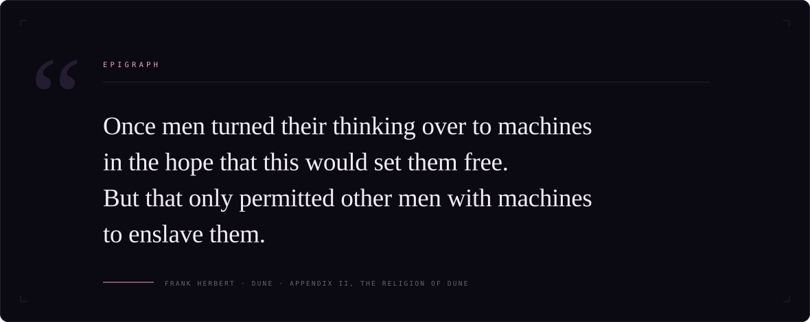
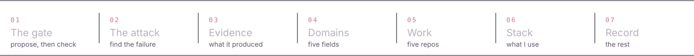

<picture>
  <source media="(prefers-color-scheme: dark)" srcset="./assets/readme/hero_dark.svg" />
  <source media="(prefers-color-scheme: light)" srcset="./assets/readme/hero_light.svg" />
  
</picture>

<a href="https://ibtasaam.com">ibtasaam.com</a> &nbsp;·&nbsp; <a href="mailto:ibtasaam.mughal@gmail.com">ibtasaam.mughal@gmail.com</a> &nbsp;·&nbsp; <a href="https://www.linkedin.com/in/muhammad-ibtasaam-amjad">LinkedIn</a> &nbsp;·&nbsp; <a href="https://ibtasaam.com/cv/muhammad-ibtasaam-amjad-cv.pdf">Download CV</a>

<picture>
  <source media="(prefers-color-scheme: dark)" srcset="./assets/readme/epigraph_dark.svg" />
  <source media="(prefers-color-scheme: light)" srcset="./assets/readme/epigraph_light.svg" />
  
</picture>

I build agentic systems, which is exactly what Herbert was warning about. So the line is not decoration here. It is the standard: the machine proposes, the human decides, and nothing gets released without a person answering for it. The work below is organised around that.

<picture>
  <source media="(prefers-color-scheme: dark)" srcset="./assets/readme/index_dark.svg" />
  <source media="(prefers-color-scheme: light)" srcset="./assets/readme/index_light.svg" />
  
</picture>

 

<picture>
  <source media="(prefers-color-scheme: dark)" srcset="./assets/readme/sec_gate_dark.svg" />
  <source media="(prefers-color-scheme: light)" srcset="./assets/readme/sec_gate_light.svg" />
  
</picture>

### [Pokayoke](https://github.com/Mughal-Hash-24/pokayoke)
`Python` `FastAPI` `Google ADK` `MCP` `Cloud Run` `React`

Holds suspect financial records before they reach the database, shows the evidence behind every correction, and will not release a row until an analyst signs off. First place, National AI Hackathon 2026.

### The Odyssey
`Python` `FastAPI` `MCP` `Redis` `n8n`

A WhatsApp-facing ReAct orchestrator. Iris delegates over MCP to specialist systems for retrieval, writing, Workspace control and engineering, with per-sender memory behind a live swarm dashboard.

### Musannif
`Python` `Textual` `NetworkX` `Anthropic` `Mistral`

Turns a topic into an editable outline, schedules sections on a dependency graph, then generates them with nine specialists. You edit the plan before a word is written.

 

<picture>
  <source media="(prefers-color-scheme: dark)" srcset="./assets/readme/sec_attack_dark.svg" />
  <source media="(prefers-color-scheme: light)" srcset="./assets/readme/sec_attack_light.svg" />
  
</picture>

### AI Agent Security
`Python` `Kaggle` `aicomp_sdk`

Red-team search against a sandboxed tool-using agent for the OpenAI / Google / IEEE challenge. Seven prompt templates, replay-validated scoring, candidate deduplication, a hard evaluation budget. Peak rank **40th worldwide**.

If other people's machines can be turned against their users, someone should find out first, and it should be the person who builds them.

 

<picture>
  <source media="(prefers-color-scheme: dark)" srcset="./assets/readme/stats_dark.svg" />
  <source media="(prefers-color-scheme: light)" srcset="./assets/readme/stats_light.svg" />
  
</picture>

 

<picture>
  <source media="(prefers-color-scheme: dark)" srcset="./assets/readme/sec_evidence_dark.svg" />
  <source media="(prefers-color-scheme: light)" srcset="./assets/readme/sec_evidence_light.svg" />
  
</picture>

### Wisdom / Kybernetes
`Obsidian` `Python` `MCP`

The vault I actually live in, exposed to agents through hand-written MCP tools for search, note management and workflows.

### Maktaba
`Next.js 15` `React 19` `TypeScript` `D3` `Supabase`

That vault, published: **370 linked notes, roughly 896,000 words**, a 4,196-section semantic index and a graph you can walk. Hikma reads it back to you.

### NAaaS / NewsNet
`Python` `spaCy` `DeBERTa-v3` `FAISS` `Leiden`

News knowledge-graph research. Fine-tuned DeBERTa-v3 NER at **93.68% micro F1 on 8,262 OntoNotes sentences**, against an 87.19% spaCy baseline.

 

<picture>
  <source media="(prefers-color-scheme: dark)" srcset="./assets/readme/sec_domains_dark.svg" />
  <source media="(prefers-color-scheme: light)" srcset="./assets/readme/sec_domains_light.svg" />
  
</picture>

<picture>
  <source media="(prefers-color-scheme: dark)" srcset="./assets/readme/domains_dark.svg" />
  <source media="(prefers-color-scheme: light)" srcset="./assets/readme/domains_light.svg" />
  
</picture>

 

<picture>
  <source media="(prefers-color-scheme: dark)" srcset="./assets/readme/sec_work_dark.svg" />
  <source media="(prefers-color-scheme: light)" srcset="./assets/readme/sec_work_light.svg" />
  
</picture>

**01** &nbsp;**[pokayoke](https://github.com/Mughal-Hash-24/pokayoke)** &nbsp;pre-submission financial QA that gates release behind analyst review 
**02** &nbsp;**[Maktaba](https://github.com/Mughal-Hash-24/Maktaba)** &nbsp;the AI-assisted knowledge library: 370 notes, 896k words, Hikma 
**03** &nbsp;**[Musannif](https://github.com/Mughal-Hash-24/Musannif)** &nbsp;multi-agent long-form writer on a dependency graph 
**04** &nbsp;**[Wisdom](https://github.com/Mughal-Hash-24/Wisdom)** &nbsp;the Obsidian vault and its MCP tooling 
**05** &nbsp;**[Chrono-Rift](https://github.com/Mughal-Hash-24/Chrono-Rift)** &nbsp;multi-process C++ game on POSIX shared memory and deadlock detection

 

<picture>
  <source media="(prefers-color-scheme: dark)" srcset="./assets/readme/sec_stack_dark.svg" />
  <source media="(prefers-color-scheme: light)" srcset="./assets/readme/sec_stack_light.svg" />
  
</picture>

<picture>
  <source media="(prefers-color-scheme: dark)" srcset="./assets/readme/stack_dark.svg" />
  <source media="(prefers-color-scheme: light)" srcset="./assets/readme/stack_light.svg" />
  
</picture>

 

<picture>
  <source media="(prefers-color-scheme: dark)" srcset="./assets/readme/sec_record_dark.svg" />
  <source media="(prefers-color-scheme: light)" srcset="./assets/readme/sec_record_light.svg" />
  
</picture>

&nbsp;&nbsp;<b>Open the full record</b> &nbsp;honours, teaching, societies, other builds

 

**Honours** · Dean's List (Fall 2024, Spring 2025, Fall 2025, Spring 2026) · Silver Medal, highest SGPA Fall 2024 · 1st Place National AI Hackathon (Pokayoke) · 1st Place GridGuard · 2nd Place Islamabad Regional Hackathon (EduGap) · 5th Place TaxNet · 4th Place DocuMind · ICPC National Preliminaries, 1st on campus and 21st nationally · IKMC Silver (2022)

**Teaching** · TA, Programming Fundamentals (CS 2025, CS 2026) · Linear Algebra (CS 2025) · Object-Oriented Programming (CS 2025) · Expository Writing (CS 2025) · Arts and Humanities (SE 2026)

**Leading** · Technical Projects Officer, FAST AI Society, where the LangChain and n8n automation runs university-wide · Tech Wing Head and Buddy Wing Chairperson, FAST Computing Society · Vice President Internals, Meri Kahani · Vice President Externals, SIMT · Head of Event, Speed UML, NaSCon 2026

**Elsewhere** · Verteon, offline posture correction on ESP32, BLE, Rust and Tauri · TaxNet, graph tax intelligence at ~0.90 F1 over 110,000 records in 48 hours · GridGuard, inspection dashboard across 7,442 meters and 11 DISCOs · Proxenos, B2B escrow on Solidity and Spring Boot · Islamagood and Baghdad Reimagined, classical-AI city simulators · Super Mario Bros in x86 MASM · ConsoleGraphicsExtension, a WinAPI console graphics library

 

<picture>
  <source media="(prefers-color-scheme: dark)" srcset="./assets/readme/close_dark.svg" />
  <source media="(prefers-color-scheme: light)" srcset="./assets/readme/close_light.svg" />
  
</picture>

<a href="https://ibtasaam.com">ibtasaam.com</a> &nbsp;·&nbsp; <a href="mailto:ibtasaam.mughal@gmail.com">ibtasaam.mughal@gmail.com</a> &nbsp;·&nbsp; <a href="https://www.linkedin.com/in/muhammad-ibtasaam-amjad">LinkedIn</a> &nbsp;·&nbsp; <a href="https://ibtasaam.com/cv/muhammad-ibtasaam-amjad-cv.pdf">CV</a>

